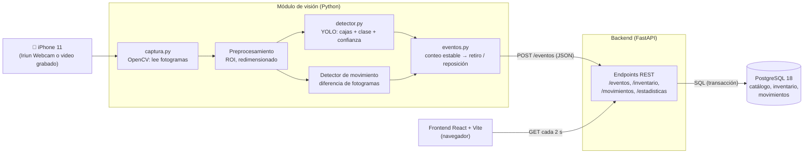
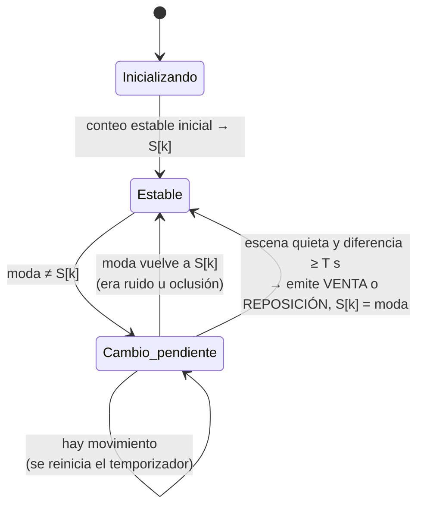
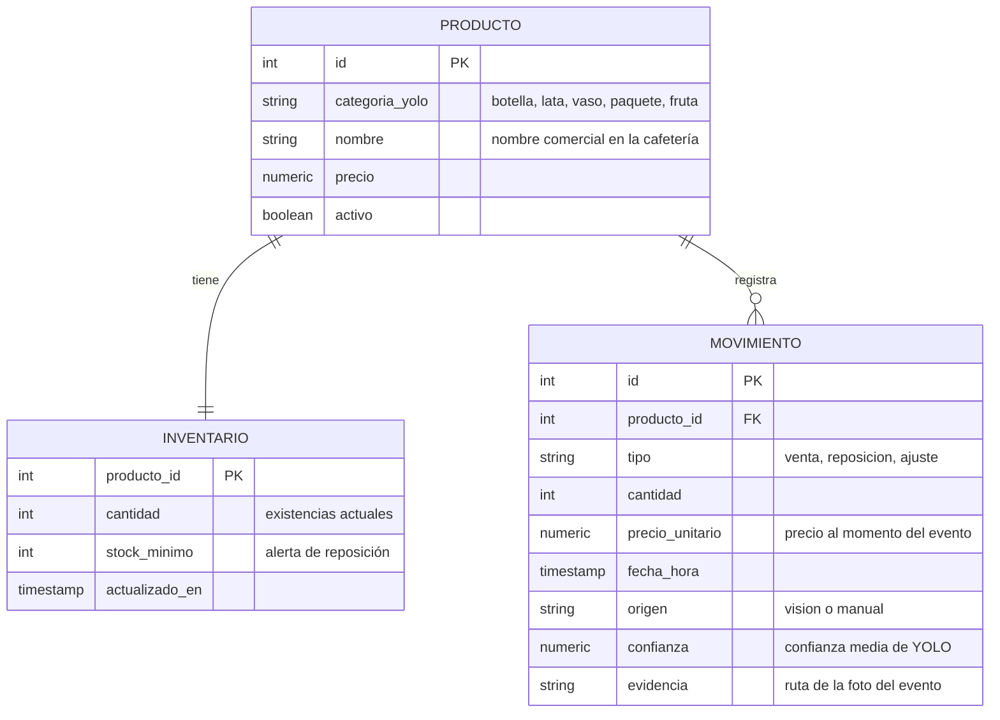

# Etapa 3 — Arquitectura del sistema

## 1. Vista general

El sistema tiene cuatro componentes que se ejecutan como procesos independientes y
se comunican por HTTP y SQL:



## 2. Función de cada tecnología

| Tecnología | Función en el proyecto | Por qué esta y no otra |
|---|---|---|
| **Python** | Lenguaje del módulo de visión y del backend | Es el ecosistema estándar de visión computacional y aprendizaje automático |
| **OpenCV** | Leer la cámara o el video, recortar la región de interés, redimensionar, detectar movimiento por diferencia de fotogramas, dibujar las cajas sobre la imagen, guardar la foto de evidencia | Biblioteca de referencia para procesamiento digital de imágenes; lee webcams, archivos y streams con la misma función |
| **YOLO (Ultralytics YOLO11n)** | Detectar y clasificar los productos en cada fotograma | Detector de una sola etapa: rápido en tiempo real; la versión *nano* entrena y corre bien en la RTX 3050 de 4 GB; permite *transfer learning* desde pesos preentrenados en COCO |
| **FastAPI** | Recibir los eventos del módulo de visión y servir los datos a la web | Mismo lenguaje que la visión; valida los datos con Pydantic; genera documentación automática en `/docs` |
| **PostgreSQL 18** | Guardar el catálogo, el inventario y cada movimiento con fecha y hora | Base relacional con transacciones: la venta y el descuento de inventario se guardan juntos o no se guarda ninguno |
| **React + Vite** | Interfaz web: inventario, historial, gráficas de ventas e ingresos | React organiza la interfaz en componentes; Vite compila y recarga rápido durante el desarrollo |

### ¿Por qué separar visión y backend?

- **Responsabilidad única:** el módulo de visión solo *observa y decide eventos*;
  el backend solo *guarda y consulta*. Cada parte se prueba por separado.
- **Robustez:** si la web se cae, la visión sigue funcionando y viceversa.
- **Reemplazable:** se puede cambiar la cámara por un video grabado (para pruebas
  reproducibles) sin tocar el backend.

## 3. Flujo de un retiro, paso a paso

```mermaid
sequenceDiagram
    participant C as Cámara
    participant V as Visión (Python)
    participant A as API (FastAPI)
    participant D as PostgreSQL
    participant W as Web (React)

    C->>V: fotograma t
    V->>V: YOLO → conteo por categoría (latas = 2)
    Note over V: Antes el conteo estable era 3.<br/>Se espera a que la escena quede quieta<br/>y el 2 se mantenga ≥ 2 s
    V->>A: POST /eventos {categoria: "lata", tipo: "venta", cantidad: 1, fecha_hora, confianza, evidencia}
    A->>D: BEGIN; INSERT movimiento; UPDATE inventario; COMMIT
    A-->>V: 201 Created
    W->>A: GET /inventario, /movimientos, /estadisticas
    A->>D: SELECT ...
    A-->>W: JSON
    W->>W: actualiza tablas y gráficas
```

## 4. Lógica de detección de retiros (núcleo del proyecto)

### 4.1 Problema

YOLO analiza cada fotograma por separado y comete errores momentáneos:
- La mano del cliente tapa productos durante un instante → el conteo baja.
- Un producto se detecta en un fotograma y en el siguiente no (parpadeo).
- Un producto retirado sigue fuera durante cientos de fotogramas.

Si se registrara una venta cada vez que el conteo baja, habría ventas falsas y
duplicadas. Por eso la decisión se toma sobre el **conteo estable**, no sobre el
conteo de un fotograma.

### 4.2 Algoritmo

Para cada fotograma *t*:

1. **Detección.** YOLO devuelve cajas con clase y confianza. Se descartan las de
   confianza menor al umbral (≈ 0,5) y las que caen fuera de la región de interés
   (la "vitrina").
2. **Conteo instantáneo.** `c_t[k]` = número de detecciones de la categoría *k*.
3. **Suavizado temporal.** Se guarda una ventana con los últimos *N* conteos
   (≈ 1,5 s de video) y se calcula la **moda** (valor más frecuente). La moda
   elimina los parpadeos aislados.
4. **Detección de actividad (procesamiento clásico).** Se compara el fotograma
   actual con el anterior en escala de grises (`absdiff` → umbral → porcentaje
   de píxeles cambiados). Si hay movimiento (una mano en la escena), **no se
   confirma ningún evento**.
5. **Confirmación.** Se mantiene un estado estable `S[k]` (lo que el sistema cree
   que hay en la vitrina). Si la moda difiere de `S[k]`, la escena está quieta y
   la diferencia se mantiene durante *T* segundos (≈ 2 s):
   - moda < `S[k]` → **venta** de `S[k] − moda` unidades.
   - moda > `S[k]` → **reposición** de `moda − S[k]` unidades.
   - Se actualiza `S[k] = moda`.

### 4.3 Diagrama de estados (por categoría)



### 4.4 Cómo se resuelve cada caso difícil

| Caso | Qué pasa | Resultado |
|---|---|---|
| La mano tapa productos | Hay movimiento y el cambio dura menos de *T* | No se registra nada |
| Parpadeo de YOLO en 1–2 fotogramas | La moda de la ventana no cambia | No se registra nada |
| Producto retirado y nunca devuelto | Tras el evento, `S[k]` ya es el valor nuevo | **Una sola venta** (sin duplicados) |
| Se retiran 2 latas a la vez | La moda baja de 3 a 1 | Una venta de 2 unidades |
| Se repone un producto | La moda sube | Reposición, no venta |
| Cliente toma un producto y lo devuelve enseguida | El cambio dura menos de *T* | No se registra nada |

Los valores de *N*, *T* y los umbrales se **calibran en la etapa 7** con videos de
prueba en los que se conoce exactamente cuántos retiros hubo.

### 4.5 Implementación (backend/app/monitor.py)

El monitoreo corre dentro del backend y acepta dos tipos de cámara, que se
eligen en la sección *Vitrina en vivo*:

| Fuente | Cómo llegan los fotogramas | Cuándo usarla |
|---|---|---|
| Cámara fija del servidor | El backend la abre con OpenCV; un hilo la lee sin parar y otro analiza el fotograma más reciente | Instalación definitiva: sigue vigilando aunque se cierre el navegador; arranca sola con `MONITOR_AUTOINICIO=true` |
| Cámara de este computador (navegador) | La página la abre con `getUserMedia` y envía ~5 JPEG por segundo a `POST /api/monitor/fotograma` | Demostraciones y pruebas desde cualquier equipo; si se dejan de recibir imágenes durante 8 s el monitoreo se detiene solo |

Las dos fuentes alimentan **el mismo algoritmo**. La visualización va aparte del
análisis, para que el video en vivo se vea fluido:

- Cámara del navegador: la página muestra su propio video a velocidad normal y
  dibuja encima los recuadros que el servidor devuelve en cada envío.
- Cámara del servidor: un hilo publicador dibuja las últimas detecciones sobre el
  fotograma más reciente unas 12 veces por segundo y lo transmite como MJPEG
  (`GET /api/monitor/video`).

La velocidad del análisis y los tiempos de quietud y confirmación se ajustan
desde la interfaz (`PATCH /api/monitor/parametros`), se aplican al instante y se
guardan en `datos/monitor_parametros.json`. El largo de la ventana se define en
segundos, así que la moda cubre el mismo tiempo a cualquier velocidad.

| Parámetro | Valor inicial | Significado |
|---|---|---|
| `fps_analisis` | 5 | Fotogramas analizados por segundo |
| `ventana_s` | 1,4 s | Historia usada para la moda (a 5 fps son 7 fotogramas) |
| `mayoria` | 60 % | Fracción mínima de la ventana que debe coincidir con la moda para que un cambio avance |
| `confirmacion_s` (*T*) | 2,0 s | Tiempo que un cambio debe mantenerse con la escena quieta |
| `quietud_s` | 1,0 s | Tiempo sin movimiento para considerar la escena quieta |
| `umbral_pixel` | 25 | Diferencia de gris para que un píxel cuente como cambiado |
| `fraccion_movimiento` | 1 % | Porcentaje de píxeles cambiados que se considera movimiento |

Al iniciar, el primer conteo estable se registra como **ajuste** (el sistema no
sabe qué pasó mientras estaba apagado); desde ahí, cada cambio confirmado es una
venta o una reposición.

**Validación con un escenario controlado** (video sintético de 24 s y un detector
de prueba por color): conteo inicial; una mano tapa productos (sin evento); se
retira 1 botella (1 venta); un objeto "parpadea" 0,1 s sin movimiento (sin
evento); la mano pasa sin tomar nada (sin evento); se repone 1 fruta (1
reposición). Resultado: exactamente los 5 movimientos esperados, sin duplicados.
Con YOLO real sobre un video de una cocina, al retirar 2 frutas a la vez se
registró una única venta de 2 unidades.

**Regla de mayoría.** Al probar la cámara del navegador con una imagen
degradada, el modelo provisional veía 0, 1 o 2 frutas en fotogramas seguidos
(12, 14 y 9 veces de 35) y la moda sola empezaba a confirmar cambios en ambas
direcciones (venta, luego reposición…). Con la regla de mayoría el sistema marcó
la detección como dudosa y no registró eventos falsos; a cambio, omitió esa
venta. Es el compromiso entre **retiros omitidos** y **registros falsos** que se
medirá en la evaluación (etapa 11); un modelo propio con confianzas altas lo
reduce.

## 5. Modelo de datos (conceptual)



Las **estadísticas** (ventas por producto, ingresos por día y por hora, producto
más vendido) no se guardan: se calculan con consultas `GROUP BY` sobre la tabla
de movimientos.

## 6. API (borrador)

| Método | Ruta | Quién la usa | Qué hace |
|---|---|---|---|
| `POST` | `/eventos` | Módulo de visión | Registra una venta o reposición y actualiza el inventario |
| `GET` | `/productos` | Web | Catálogo |
| `GET` | `/inventario` | Web | Existencias actuales con alerta de stock bajo |
| `GET` | `/movimientos` | Web | Historial (filtros por fecha, tipo y producto) |
| `GET` | `/estadisticas` | Web | Ventas e ingresos agregados |
| `POST` | `/movimientos/ajuste` | Web | Corrección manual (queda marcada como `manual`) |

### 6.1 Inventario por foto (implementado)

Antes del módulo de video en vivo, el inventario ya se actualiza con visión desde
una foto de la vitrina (sección *Vitrina* de la web):

| Método | Ruta | Qué hace |
|---|---|---|
| `POST` | `/api/inventario/conteo` | Recibe la foto, la guarda como evidencia, corre YOLO y compara el conteo con el inventario (no modifica nada) |
| `POST` | `/api/inventario/sincronizar` | Recalcula el conteo sobre la misma foto y, en una transacción, iguala el inventario: bajadas → **venta**, subidas → **reposición** (o **ajuste** en el conteo inicial) |
| `GET` | `/api/panel` | Indicadores del día, existencias y últimos movimientos |
| `GET` | `/api/vision/modelo` | Modelo en uso y categorías que puede detectar |

Decisiones:
- El conteo se **recalcula en el servidor** al confirmar; no se confía en números
  enviados por el navegador.
- Solo se modifican las categorías que el modelo **puede detectar**. Con el modelo
  provisional (YOLO preentrenado en COCO: `bottle`→botella, `cup`→vaso,
  `banana`/`apple`/`orange`→fruta) las latas y los paquetes no se tocan; de lo
  contrario "no detecté latas" se registraría como venta de todas las latas.
- La misma foto confirmada dos veces no genera movimientos duplicados, porque la
  segunda vez el inventario ya coincide con lo que se ve.
- El módulo `vision/detector.py` es el mismo que usará el video en vivo (etapa 7).

## 7. Modos de entrada de video

| Modo | Fuente | Uso |
|---|---|---|
| Archivo | Video grabado con el iPhone (`datos/videos_prueba/*.mp4`) | Desarrollo, calibración y evaluación (resultados repetibles) |
| En vivo | iPhone como webcam con Iriun (`cv2.VideoCapture(índice)`) | Demostración |

Ambos modos usan la misma función de OpenCV, así que el resto del sistema no
cambia.

## 8. Conceptos de la asignatura que se aplican

| Concepto | Dónde aparece |
|---|---|
| Procesamiento digital de imágenes | Escala de grises, diferencia de fotogramas, umbralización, ROI, redimensionado |
| Visión computacional | Análisis de video en tiempo real y extracción de eventos |
| Detección y clasificación de objetos | YOLO con 5 categorías |
| Preparación y etiquetado de imágenes | Dataset propio en formato YOLO, aumento de datos |
| Entrenamiento y evaluación | *Transfer learning*, mAP, precisión, recall, matriz de confusión |
| Extracción de información | Conteos → eventos de venta/reposición con fecha y hora |
| Almacenamiento | PostgreSQL con transacciones |
| Visualización e interpretación | Panel web con inventario, historial y estadísticas |
